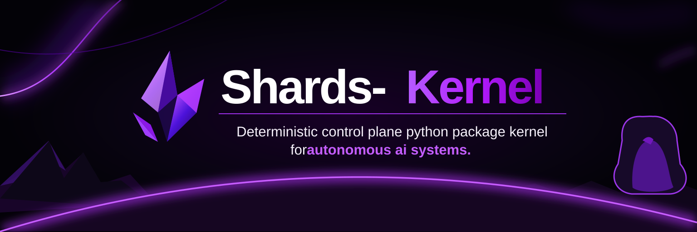

# Shards-Kernel — Deterministic Control Planes for AI Systems



[](https://github.com/Shards-foundation/Shards-kernel/actions/workflows/ci.yml)
[](https://codecov.io/gh/Shards-foundation/Shards-kernel)
[](https://pypi.org/project/shards-kernel/)
[](https://github.com/Shards-foundation/Shards-kernel/blob/main/LICENSE)

A **kernel** is a deterministic state machine that governs AI agent execution via **jurisdiction**, **fail-closed arbitration**, and an **append-only hash-chained audit ledger**.

**Hard constraint:** no tool execution without an explicit `ALLOW`; no `ALLOW` without a committed audit decision.

---

## Try it in your terminal

Install the published package with the optional cryptographic demo support, verify the Python namespace and CLI, and run a **local, offline** permit-and-audit demonstration:

```bash
python -m pip install "shards-kernel[crypto]==0.1.3"
python -c "import shards_kernel; print(shards_kernel.__version__)"
shards-kernel --version
shards-kernel info --variant strict
shards-kernel demo --json
```

### Optional mission-control terminal UI

The regular install remains dependency-free. For a colour terminal welcome screen and
a short operator-menu experience, install the optional `tui` extra:

```bash
python -m pip install "shards-kernel[tui]"
shards-kernel
# Or explicitly:
shards-kernel dashboard
shards-kernel dashboard --no-animate --no-interactive
shards-kernel dashboard --plain --no-interactive
```

The menu provides only **local, explicitly selected** information, a library preflight,
an offline demo, and command help. It does not connect to an issuer, verify agent
connectivity, or certify deployment readiness. Runtime status remains **NOT VERIFIED**
until the relevant real diagnostics have run.

The CLI preserves plain `--help`, `--version`, `demo --json`, and `doctor --json`
output for scripts and MCP integrations. Non-interactive launches never prompt.
Set `NO_COLOR=1` for plain output or `SHARDS_NO_ANIMATION=1` to disable animation.
The visual UI does **not** run automatically as part of `pip install`.

---

The **PyPI project name** is `shards-kernel`, the **Python import** is `shards_kernel` (not `kernels`), and the **terminal executable** is `shards-kernel`. This demo exercises the built-in `echo` tool; it does not grant an agent access to external systems. See [installation](#install), the [agent quickstart](docs/AGENT_QUICKSTART.md), and the [import migration guide](docs/PACKAGE_MIGRATION.md).

---

## Problem (Operational, Not Philosophical)

Ungoverned agent systems fail in predictable ways:

| Failure Mode | Consequence |
|--------------|-------------|
| Ambiguity escapes into execution | Actions occur without a crisp, auditable decision boundary |
| Implicit state drift | Post-hoc analysis becomes narrative, not replay |
| Tool reach exceeds operator intent | "Capability" becomes "authority" |
| Logs are advisory | Missing transitions = missing truth |
| Accountability diffuses | No single place to prove "why this happened" |

Shards-Kernel exists to make those failure modes **structurally expensive** and **forensically obvious**.

---

## When to use Shards-Kernel

Shards-Kernel is designed for the boundary between **what an AI agent proposes** and **what it is authorised to execute**. It becomes particularly useful when an agent can cause consequential changes: editing files, deploying code, calling third-party APIs, spending funds, handling sensitive data, or directing other agents. A successful prompt or capable model is **not** an execution permission.

For these workflows, a control plane can require explicit policy decisions, narrowly scoped permits, **fail-closed** handling of unknown or unauthorised requests, and hash-chained audit evidence of the decision and outcome. Shared enforcement rules can also keep multiple agents and services from inventing inconsistent permission boundaries.

| Integration scenario | Why a governed execution boundary matters |
|---|---|
| Repository maintenance and deployments | Restrict which agent may edit a repository, open a pull request or initiate a deployment |
| External API access | Bind each operation to an identified actor, approved tool and permitted parameters |
| Financial or other high-impact operations | Require separately granted authority and refuse actions outside explicit scope |
| Sensitive-data workflows | Limit the tools and operations an agent may invoke; preserve evidence for review |
| Multi-agent orchestration | Apply a common approval and audit policy when work passes between agents |

**Current scope:** these are *integration use cases*, not a claim that the released package ships GitHub deployment, wallet, financial execution, or sensitive-data connectors. The signed local reference operator currently exposes only `echo` and `add`; further operations require a separately built and trusted integration with appropriate process isolation, authentication and external controls. Shards-Kernel is **not** a sandbox and cannot constrain tools that bypass its execution path.

---

## Model

```
OPERATOR (authority) ── KernelRequest ──▶ KERNEL (policy+state+audit) ──▶ TOOL REGISTRY
       ▲                                           │
       └───────────── KernelReceipt ◀──────────────┘

AGENT has no direct tool access; it submits requests and receives results.
```

Separation is the point:

| Component | Responsibility | Authority |
|-----------|----------------|-----------|
| Operator | Sets policy, reviews evidence, halts | Highest |
| Kernel | Validates, arbitrates, records | Delegated |
| Tool registry | Executes sanctioned ops | None |
| Agent | Requests + consumes results | None |

---

## Core Invariants (Normative)

A compliant kernel MUST satisfy:

| ID | Invariant | Description |
|----|-----------|-------------|
| INV-STATE | Single state | Exactly one state at any time |
| INV-TRANSITION | Explicit transitions | Transitions only via declared functions |
| INV-JURISDICTION | Policy enforcement | Every request passes policy before execution |
| INV-AUDIT | Audit completeness | Every transition emits an audit entry before completion |
| INV-HASH-CHAIN | Chain integrity | Audit entries chain to previous hash |
| INV-FAIL-CLOSED | Deny on ambiguity | Ambiguity/malformed/unhandled ⇒ `DENY` or `HALT` |
| INV-DETERMINISM | Reproducibility | Identical inputs + initial state ⇒ identical outputs |
| INV-HALT | Halt availability | Halt intent blocks new admission immediately; terminal `HALTED` follows the in-flight outcome audit |
| INV-EVIDENCE | Exportability | Decisions exportable as verifiable evidence bundle |
| INV-NO-IMPLICIT-ALLOW | Explicit permission | "Not denied" ≠ allowed; explicit `ALLOW` required |

---

## State Machine (Canonical)

```
BOOTING → IDLE → VALIDATING → ARBITRATING → AUDITING (intent)
        → EXECUTING → AUDITING (outcome) → COMPLETED → IDLE
Any unhandled exception ────────────────────────────────────────▶ HALTED
```

---

## Public API (Supported Surface)

Treat everything else as internal. Your stable integration points:

```python
from shards_kernel import (
    # Core types
    Kernel,              # Protocol / interface
    KernelRequest,       # Request structure
    KernelReceipt,       # Response structure
    Decision,            # ALLOW | DENY | HALT
    KernelConfig,        # Configuration
    
    # Variants
    StrictKernel,        # Maximum enforcement
    PermissiveKernel,    # Relaxed thresholds
    EvidenceFirstKernel, # Requires evidence field
    DualChannelKernel,   # Requires constraints dict
    
    # Tooling
    ToolRegistry,        # Tool registration + dispatch
    
    # Evidence
    replay_and_verify,   # External verification
    verify_evidence_bundle,
)
```

If a module is not reachable via `shards_kernel.api`, it is **not** a supported API surface.

---

### Direct synchronous concurrency

`kernel.submit()` uses **single-flight, non-blocking admission**: exactly one submission owns an instance's state machine; simultaneous calls immediately return an audited `Decision.DENY` / `KERNEL_BUSY` receipt before permit verification or tool dispatch. A busy denial does **not** consume a permit, prove signature validity, or mean the request was evaluated against policy. The audit ledger serializes concurrent append/export. An operator calling `halt()` during an active handler receives `ReceiptStatus.QUEUED`, `HALT_QUEUED` and a nonterminal `state_to`; the session moves to `HALTED` only after the handler's outcome is audited. The authenticated Flask/FastAPI `POST /halt` endpoints return **HTTP 202** with `status: halt_queued`, `receipt_status: QUEUED`, `halt_confirmed: false` and receipt/audit metadata. Clients must poll the authenticated `GET /status` until `HALTED`; **HTTP 200** with `halt_confirmed: true` confirms the terminal halt was completed before the response (including an in-flight request that finished during the halt audit). A queued receipt is never proof of effect cancellation. Because Python threads cannot safely pre-empt running tools, stalled effects require external process supervision. This is **not** a queue, hard timeout, cross-process lock or universal exactly-once guarantee. Use PostgreSQL authority for shared permits and provider-level idempotency and reconciliation for external effects.

## Kernel Variants

Variants tune posture while preserving invariants:

| Variant | Posture | Key Requirement |
|---------|---------|-----------------|
| **StrictKernel** | Maximal enforcement | Strict ambiguity handling |
| **PermissiveKernel** | Relaxed thresholds | Intent-only allowed |
| **EvidenceFirstKernel** | Evidence-required | `evidence` field mandatory |
| **DualChannelKernel** | Structured constraints | `constraints` dict required |

---

## Install

The PyPI distribution name is `shards-kernel`, the import namespace is `shards_kernel`, and the CLI command is `shards-kernel`:

```bash
python -m pip install "shards-kernel==0.1.3"
python -c "import shards_kernel"
shards-kernel --help
```

**Version 0.1.3 is the security and concurrency stabilisation release**: exact signed-parameter scope, audited single-flight admission and unambiguous queued-halt receipts. Verified artifacts are published through [PyPI](https://pypi.org/project/shards-kernel/) only after protected merge, release acceptance and GitHub OIDC Trusted Publishing. The different PyPI project [`kernels`](https://pypi.org/project/kernels/) belongs to Hugging Face; do **not** install `kernels` when intending to install Shards-Kernel. To use the development checkout instead:

```bash
python -m pip install "git+https://github.com/Shards-foundation/Shards-kernel.git"
```

Or clone it and install the checkout in editable mode:

```bash
git clone https://github.com/Shards-foundation/Shards-kernel.git
cd Shards-kernel
python -m pip install -e .
```

Both approaches provide `import shards_kernel` and the `shards-kernel` command.

For existing users migrating from the old `kernels` Python import path, see [the package migration guide](docs/PACKAGE_MIGRATION.md).

### Execution and evidence boundaries

These boundaries are included in Shards-Kernel 0.1.1 and later. Older
published versions do not include the complete hardening fixes.

- Registered tools are trusted Python code; the kernel is not an operating-system
  sandbox and cannot prevent code with direct access to a tool from calling it.
  Protect tool access at the process and deployment boundaries.
- Permit parameters are matched with type-strict JSON values. Handler defaults
  are included in the authorized and audited parameters; operators must include
  them in the permit. A handler can still interpret its arguments internally,
  so register only implementations whose behavior you trust.
- `max_time_ms` permits are refused before execution: the synchronous runtime
  cannot enforce a hard deadline or roll back effects already performed.
- An async wait timeout or cancellation does not stop a synchronous tool that
  is already running. The async wrapper keeps other operations serialized
  until it finishes; inspect the audit trail before deciding whether to retry.
  Serialization covers calls through the same wrapper, so do not share its
  underlying kernel with concurrent direct callers or additional wrappers.
- Evidence replay checks hash-chain consistency. The bundle's own root hash and
  identity labels do not establish provenance; compare against an independently
  trusted root or use an external attestation mechanism. An explicitly empty
  ledger is valid only with the genesis root.
- A halted kernel instance is terminal. Create a new instance and restore a
  verified ledger when recovery is required.

## Agent-ready local MCP integration (first release scope)

**An agent can use this kernel today without a separate Shards MCP Gateway.**
The installable `shards-kernel mcp-call` command is a one-shot official
MCP SDK v2 client for an enrolled agent; the existing `mcp-relay` command
also supports stdio MCP hosts directly. A distinct signed v2 local operator,
agent-scoped bearer and independently issued one-use permit are required.

```bash
# Python 3.11+; uses an existing signed local operator and issued permit.
python -m pip install -e ".[crypto,mcp]"
shards-kernel demo --json
shards-kernel mcp-call --help
# Following trusted operator/issuer provisioning, same-host agent:
shards-kernel mcp-call --port 8765 --tool echo \
  --arguments-json '{"text":"Hello from my agent"}' \
  --permit-file /absolute/private/path/to/issued-echo-permit.json
```

See the [agent-first getting started guide](docs/AGENT_QUICKSTART.md) for
the operator trust prerequisites, secret handling, MCP-host integration,
expected responses and reproducible acceptance. This is **a usable local
reference product**, not a deployed remote MCP Gateway, a trading executor
or production certification. The latter are separately gated.

## Reproducible offline permit demonstration

Verify the complete local deny → approved execution → replay/expiry/revocation
denial → verified audit restoration sequence using an ephemeral Ed25519 issuer:

```bash
python -m pip install -e ".[crypto]"
shards-kernel demo
shards-kernel demo --json
```

This demonstration executes only the built-in `echo` tool. It uses an isolated
test clock and an in-memory evidence bundle; it is **not a live gateway,
trusted issuer deployment, or evidence of production readiness**. See
[offline acceptance demo](docs/operations/OFFLINE_PERMIT_DEMO.md).

## Separate offline permit issuer and human approver

`shards-kernel issuer approve` and `shards-kernel issuer sign` provide
two **offline-only**, distinct Ed25519 authorities: a human-reviewed
signature of an exact unsigned permit draft, followed by a separately
trusted issuer signature. Private keys are provided only via inherited
file descriptors, never the Shards-Kernel HTTP/MCP service.

This is a **local reference workflow**, not a KMS-backed production issuer.
It limits signed capabilities to single-execution, short-lived built-in
`echo` and `add` tools. See the
[offline issuer guide](docs/operations/OFFLINE_ISSUER.md) for exact
commands, approval steps, threats and limitations.

## Certificate-pinned HTTPS ingress for remote agent transport

The optional `shards-kernel mtls-ingress --config <signed-ingress.json>`
provides a separate TLS 1.3 mutual-authentication boundary. It validates
an offline Ed25519-signed ingress policy and two or more pinned client
certificate fingerprints before forwarding **only** governed submissions
to the existing loopback operator. Each request still requires its own
enrolled agent bearer and separate signed execution permit. Administrative
halt/evidence/status/policy routes are not forwarded.

**This is a restricted HTTPS reference, NOT a native network MCP server,
deployed gateway or production approval.** See the
[mTLS agent ingress runbook](docs/operations/MTLS_AGENT_INGRESS.md).

## Official MCP SDK v2 multi-agent local relay

`shards-kernel mcp-relay --port <local-operator-port>` exposes a single
`governed_execute` tool over the **official MCP v2 stdio transport**. It
bridges a separately enrolled agent's bearer into the signed-policy HTTP
operator on loopback, which enforces actor identity, tool scope and a
separate Ed25519 permit. Two independent MCP stdio clients can use
distinct credentials without holding operator privileges.

Requires `shards-kernel[mcp,crypto]` on Python 3.11+ and one
`SHARDS_KERNEL_AGENT_TOKEN` securely injected per local MCP client.
**No remote MCP/OIDC/mTLS or financial tools have been implemented.**
See [two-agent MCP operator guide](docs/operations/MCP_TWO_AGENT_RELAY.md).

## Two-agent identity boundary (local reference)

A signed **operator config v2** can enroll 2–16 separate agents, each
with a unique high-entropy bearer token and its own tool allowlist. The
signed file stores only memory-hard scrypt token verifiers, not raw bearer secrets.
A separate operator-held `SHARDS_KERNEL_AGENT_AUTH_PEPPER` supplies the
MAC key outside the signed policy.
`POST /submit` binds each authenticated bearer to the exact actor and
its permitted tool; a **separately signed Ed25519 permit is still
mandatory**. The distinct operator bearer alone can access halt,
evidence, status and policy endpoints; it cannot execute as an agent.

This is **loopback only** and does not establish remote workload
identity, OAuth/mTLS or distributed replay prevention. See the
[two-agent local identity guide](docs/operations/TWO_AGENT_IDENTITY.md).

## Restricted local operator service

A standalone, loopback-only HTTP reference service is available with pinned
**public-only Ed25519** issuer keys, real UTC clock, strictly allowlisted
built-in tools, one locally authenticated actor and SQLite audit/replay recovery:

```bash
python -m pip install -e ".[crypto]"
shards-kernel serve --config /absolute/path/to/signed-operator-policy.json
```

It will **refuse startup** without a valid **Ed25519-signed operator policy**, a
separately pinned `SHARDS_KERNEL_POLICY_PUBLIC_KEY_HEX`, and
`SHARDS_KERNEL_API_KEY` set to a protected strong bearer credential. It
cannot run financial tools or bind remote interfaces. Unsigned policies require
an explicit development-only `--allow-unsigned-local` flag. See the
[operator service guide](docs/operations/LOOPBACK_OPERATOR_SERVICE.md)
for config fields, trust boundaries and unverified production requirements.

## Operator readiness checks

The `shards-kernel doctor` CLI is a **preflight inspection**, not a
production deployment certificate. By default it checks service prerequisites,
reports every unverified runtime guarantee, and exits **2** when operational
readiness is not demonstrated:

```bash
shards-kernel doctor
shards-kernel doctor --json
shards-kernel doctor --profile library --json
```

The `library` profile checks local package prerequisites and may pass with
exit code **0**; it does **not** imply the control plane is safely deployed.
The `service` profile intentionally reports `NOT_VERIFIED` for issuer trust,
durable audit/replay recovery and remote agent identity until independent
runtime validation exists. API credentials are never printed.

See [operator preflight guide](docs/operations/OPERATOR_PREFLIGHT.md).

## HTTP server authentication

The HTTP server and Flask/FastAPI adapters require a configured bearer key.
Without one, they refuse to start; audit exports, policy inspection, submit,
status and halt are authenticated routes. The SDK's `api_key` argument now
has a corresponding server-side check.

```bash
export SHARDS_KERNEL_API_KEY="$(python -c 'import secrets; print(secrets.token_urlsafe(48))')"
python -m shards_kernel.sdk.server
curl --fail http://127.0.0.1:8080/health
curl --fail -H "Authorization: Bearer ${SHARDS_KERNEL_API_KEY}" http://127.0.0.1:8080/status
```

This is a local **reference** HTTP interface, not a production-ready public
multi-agent gateway. Do not publicly expose the built-in server.
See [HTTP authentication and deployment limitations](docs/operations/HTTP_API_AUTH.md).

## Quickstart

```bash
git clone https://github.com/Shards-foundation/Shards-kernel.git
cd Shards-kernel
python -m pip install -e .
python -m unittest discover -s tests -v
bash scripts/smoke.sh
python examples/01_minimal_request.py
python -m shards_kernel --help
```

## Runnable Demos

The repository includes deterministic, offline examples for request handling,
fail-closed decisions, evidence verification, and durable SQLite audit recovery. Start with
[the demo guide](docs/DEMOS.md).

```bash
python -m pip install -e ".[dev]"
python examples/01_minimal_request.py
python examples/02_verify_evidence.py
python examples/03_fail_closed_ambiguity.py
python examples/04_sqlite_persistent_ledger.py
```

The SQLite demo injects a SQLite-backed audit ledger into the kernel and checks
that verified evidence is restored after restart. See the demo guide for the
scope and operational limitations.

## Organisation-wide repository review automation

Use the safe **read-only GitHub API inventory** to inspect repository metadata,
last-push age and (optionally) reported default-branch protection. The command
**does not** clone, install, execute, reset or delete anything:

```bash
python scripts/org_repo_review.py --org Shards-foundation --format json
python scripts/org_repo_review.py --org Shards-foundation --check-branches --strict
```

The script emits structured operational events to stderr and JSON or Markdown
reports to stdout. Inject `GITHUB_TOKEN` in the environment for access
to private repositories; an anonymous call only sees the publicly accessible
subset. Legacy `--workspace` and `--output` workflow arguments are
intentionally unsupported because they previously enabled destructive actions.

See [the safe organisation inventory runbook](docs/operations/ORGANISATION_INVENTORY.md)
for operational limits, report formats and exit codes.

## Autonomous Codex contribution scaffold

Local scripts under `scripts/agents/` support a closed-loop contribution
workflow. `.github/workflows/codex-pr-generator.yml` and
`.github/workflows/codex-self-heal.yml` are not in this repository. The workflow
files that are present are:

- `.github/workflows/ci.yml`
- `.github/workflows/dependency-canary.yml`
- `.github/workflows/dependency-health.yml`
- `.github/workflows/docs.yml`
- `.github/workflows/jekyll-gh-pages.yml`
- `.github/workflows/release.yml`
- `.github/workflows/security.yml`
- `.github/workflows/smoke.yml`
- `.github/workflows/static.yml`

The local scripts are:

- `scripts/agents/codex_generate_patch.py` writes auditable run payloads to
  `.codex/runs/`.
- `scripts/agents/build_codex_prompt.py` injects kernel skill constraints from
  `skills/` into an agent-ready prompt payload with failure-aware routing.
- `scripts/agents/append_metrics.py` attaches benchmark deltas to each run.
- `scripts/agents/evaluate_run.py` scores runs and updates
  `.codex/meta/leaderboard.json` and `.codex/memory/*.json` for active memory.
- `scripts/agents/run_end_to_end.py` executes the full loop in one command
  (run generation → metrics attach → prompt build → evaluation).

Quick local smoke test:

```bash
python scripts/agents/codex_generate_patch.py .github/ISSUE_TEMPLATE/feature_request.md
latest_run="$(ls -td .codex/runs/* | head -n1)"
python scripts/agents/append_metrics.py benchmarks/results.sample.json "$latest_run"
python scripts/agents/build_codex_prompt.py "$latest_run/request.json" --run-dir "$latest_run" --out "$latest_run/prompt.json"
python scripts/agents/evaluate_run.py "$latest_run"

# or run all stages:
python scripts/agents/run_end_to_end.py .github/ISSUE_TEMPLATE/feature_request.md --metrics benchmarks/results.sample.json
```

---

## Specs + Docs

**Specifications** (normative):

| Document | Content |
|----------|---------|
| [spec/SPEC.md](https://github.com/Shards-foundation/Shards-kernel/blob/main/spec/SPEC.md) | Normative requirements |
| [spec/STATES.md](https://github.com/Shards-foundation/Shards-kernel/blob/main/spec/STATES.md) | State machine + transitions |
| [spec/JURISDICTION.md](https://github.com/Shards-foundation/Shards-kernel/blob/main/spec/JURISDICTION.md) | Policy rules |
| [spec/AUDIT.md](https://github.com/Shards-foundation/Shards-kernel/blob/main/spec/AUDIT.md) | Ledger + hashing + evidence bundle |
| [spec/ERROR_MODEL.md](https://github.com/Shards-foundation/Shards-kernel/blob/main/spec/ERROR_MODEL.md) | Error taxonomy |
| [spec/VARIANTS.md](https://github.com/Shards-foundation/Shards-kernel/blob/main/spec/VARIANTS.md) | Posture variants |

**Architecture + Threat Model**:

| Document | Content |
|----------|---------|
| [docs/ARCHITECTURE.md](docs/ARCHITECTURE.md) | Component boundaries and data flows |
| [docs/THREAT_MODEL.md](docs/THREAT_MODEL.md) | Adversary model + mitigations |
| [docs/pipelines/HPC_CICD_ARCHITECTURE.md](docs/pipelines/HPC_CICD_ARCHITECTURE.md) | Production-grade CI/CD architecture for kernel projects |
| [docs/FAQ.md](docs/FAQ.md) | Usage clarifications |

---

## What This Refuses To Be

| Not This | Because |
|----------|---------|
| LLM wrapper | Doesn't call models |
| Prompt framework | Doesn't "improve" prompts |
| Agent framework | Doesn't define behaviour |
| "Alignment" | Doesn't solve values |
| RBAC | Jurisdiction is execution-boundary enforcement |
| Dashboard | Outputs evidence; visualisation is out of scope |

It does one job: **deterministic arbitration with immutable audit**.

---

## Versioning Policy

SemVer with strict interpretation:

| Version | Meaning |
|---------|---------|
| `0.x.y` | Development; invariants stable; API may change |
| `1.0.0` | Invariants + API surface frozen |

**Breaking change** = any change to invariants, transitions, audit schema, or public types.

---

## Legal / Privacy (Review Drafts)

- [Terms of Service and Conditions of Use](TERMS_OF_SERVICE.md) — distinguishes the existing MIT software licence from optional project-operated support and community activities.
- [Privacy Policy](PRIVACY_POLICY.md) — explains local operator-controlled audit data versus information voluntarily shared with project maintainers.
- [Legal adoption checklist](docs/legal/ADOPTION_CHECKLIST.md) — outstanding corporate identity, processing/retention and independent legal-review requirements.

**These documents are drafts and have not been formally adopted.** The [MIT licence](LICENSE) continues to govern your rights to use and redistribute the software. The current package is not a hosted Shards MCP Gateway or trading service.

---

## Contributing / Security

See [CONTRIBUTING.md](CONTRIBUTING.md) and [SECURITY.md](SECURITY.md).

---

## License

[MIT](LICENSE)
