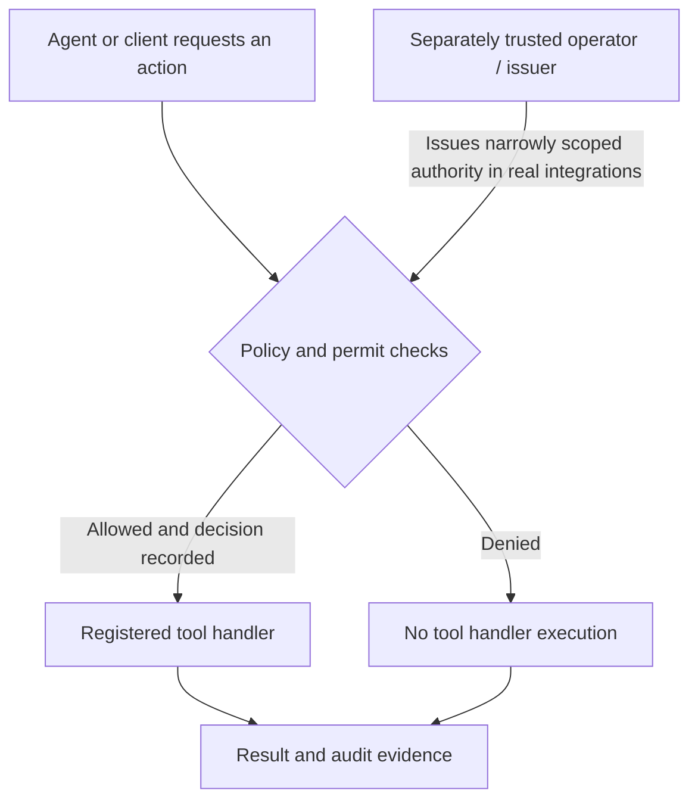

# Shards-Kernel product tour

**Authorise the action. Verify the permit. Record the decision.**

Shards-Kernel is an open-source Python SDK that governs AI-agent tool requests routed through its policy and permit boundary. Start with the offline demonstration below. It requires no cloud account, model API key, external agent or hosted service.

[Back to README](../README.md) · [Choose an integration](AGENT_SELECTION.md) · [Agent setup](AGENT_QUICKSTART.md) · [Security model](THREAT_MODEL.md) · [Contribute](../CONTRIBUTING.md)

## The problem it addresses

An agent proposing an action is not the same as an operator authorising it. Shards-Kernel separates a request from the authority to execute it.



This is a conceptual view of a governed integration, not a claim that the offline demonstration deploys an external operator or agent. Only operations routed through the enforced boundary are governed.

## Try the real offline demo

In a trusted terminal with Python installed, run:

```bash
python -m pip install "shards-kernel[crypto]"
shards-kernel --version
shards-kernel doctor --profile library --json
shards-kernel demo --json
```

The demonstration executes the built-in `echo` handler with an ephemeral Ed25519 issuer, a virtual clock and in-memory audit evidence. It uses no production credentials or external effects.

### What the command checks

| Gate | Expected outcome |
| --- | --- |
| No signed permit | Denied |
| Correctly signed, scoped permit | Allowed once |
| Same permit submitted twice | Denied as replay |
| Arguments changed after approval | Denied for scope mismatch |
| Expired signed permit | Denied |
| Revoked issuer verification key | Denied |
| Verified evidence restored into a fresh kernel | Previously consumed permit remains denied |

These are the seven acceptance gates documented in the [offline demo reference](operations/OFFLINE_PERMIT_DEMO.md). The command exits with status `0` when all gates pass, otherwise `2`. In JSON mode, inspect each gate, the audit root and `passed`.

The demo deliberately reports `production_ready: false`. That describes the **synthetic demo environment**; it does not mean the published Python library cannot be installed or used locally.

### Record evidence rather than trusting a screenshot

For a reproducible assessment, retain the exact installed version, command exit status and unmodified JSON results. If a command cannot run, report **NOT TESTED**, not PASS.

Do not paste private operator credentials, signed production permits or user data into issue comments or public logs.

## Where to go next

| Your goal | Next step |
| --- | --- |
| Evaluate whether the SDK fits your use case | [Agent selection and verification](AGENT_SELECTION.md) |
| Learn the Python API and inspect runnable examples | [Demo guide](DEMOS.md) and [SDK examples](../examples) |
| Use the optional terminal dashboard | [README: mission-control UI](../README.md#optional-mission-control-terminal-ui) |
| Connect an enrolled agent through a local signed operator | [Agent quickstart](AGENT_QUICKSTART.md) |
| Understand issuer, operator and client separation | [Two-agent identity boundary](operations/TWO_AGENT_IDENTITY.md) |
| Evaluate failure modes and trust assumptions | [Threat model](THREAT_MODEL.md) |
| Report a bug or propose a change | [Contributing guide](../CONTRIBUTING.md) |

## What this does not prove

The local demo does **not** establish OS process isolation, universal control of arbitrary tools, independent audit anchoring, crash-safe external side effects, a deployed multi-host service, or enterprise production readiness.

A deployed integration must separately prove authentication, issuer isolation, process boundaries, persistence, crash recovery, external-effect reconciliation and any relevant transport security. See the [agent selection guide](AGENT_SELECTION.md) before making deployment claims.

---

**Documentation status:** This tour describes repository-supported local behaviour. It is not a live hosted demonstration or a certification report.
